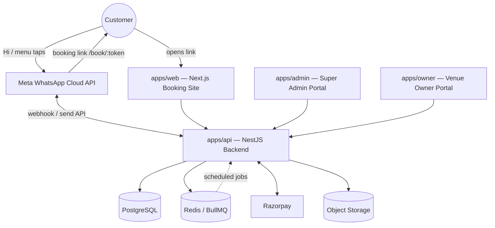
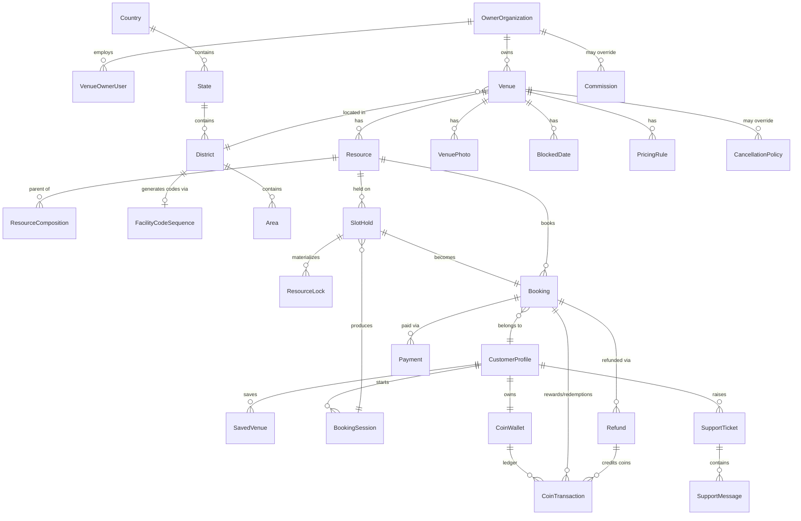
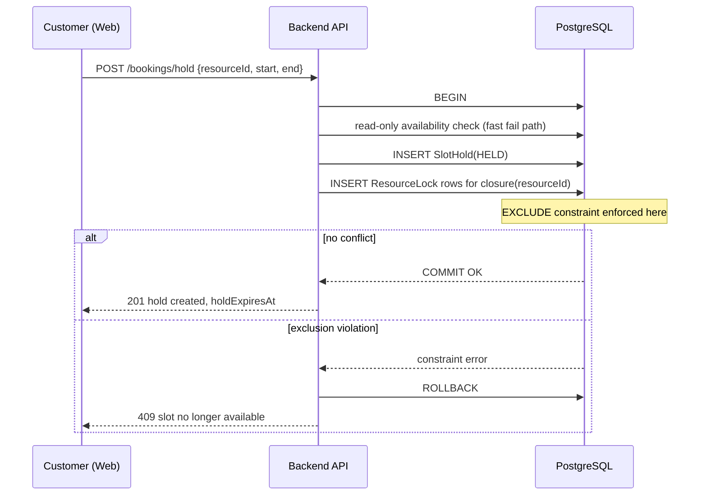

# Venue Booking Platform — Architecture & Design (Phase 1)

Status: **DRAFT — awaiting approval before Phase 2 (implementation) begins.**

This document covers the required Phase 1 deliverables: architecture, database
schema/ERD, state machines, conflict algorithm, payment flow, coin ledger,
RBAC model, API/module structure, frontend structure, edge cases, and the
phased build plan.

---

## 1. Scope, Assumptions & Open Questions

The brief is thorough but a few things are genuinely ambiguous or in tension
with each other. Rather than silently guessing, here is what I assumed and
why — flag anything you want changed before Phase 2.

| #   | Issue                                                                                          | Assumption made                                                                                                                                                                                                                                                                                                                                                                                                   | Why                                                                                                                                     |
| --- | ---------------------------------------------------------------------------------------------- | ----------------------------------------------------------------------------------------------------------------------------------------------------------------------------------------------------------------------------------------------------------------------------------------------------------------------------------------------------------------------------------------------------------------- | --------------------------------------------------------------------------------------------------------------------------------------- |
| 1   | Razorpay is India-only, but the platform must be "global expansion ready"                      | Payments go through a `PaymentProvider` interface. Razorpay is the first implementation. Currency is a field on every money-bearing table, not hardcoded to INR.                                                                                                                                                                                                                                                  | Lets us add Stripe/PayPal later without touching booking/coin logic.                                                                    |
| 2   | "1 Coin = ₹1" is stated as a global rule, but coins can't have a fixed value across currencies | Coin value is **pegged 1:1 to the customer's home currency** (1 Coin = 1 unit of whatever currency they transact in), stored per-wallet with a `currency` field. Kerala launch = 1 Coin = ₹1. A coin earned in INR cannot be spent against a booking priced in another currency (cross-currency wallets are out of scope for v1).                                                                                 | Preserves the 1:1 rule everywhere while not baking in INR permanently.                                                                  |
| 3   | Cancellation policy — "do not hard-code one global policy"                                     | `CancellationPolicy` is a configurable table with time-tiered refund percentages (e.g. ≥24h = 100%, 12–24h = 50%, <12h = 0%). Platform has one default policy; a venue may override it.                                                                                                                                                                                                                            | Matches the explicit instruction.                                                                                                       |
| 4   | Commission model                                                                               | `Commission` is configurable per organization (owner) with a platform default fallback; supports PERCENTAGE or FLAT.                                                                                                                                                                                                                                                                                              | Owner portal needs to show "platform fee" per the example given.                                                                        |
| 5   | Venue Owner may have staff/multiple venues                                                       | Introduced `OwnerOrganization` as the billing/ownership entity, with `VenueOwnerUser` (login accounts) belonging to it, and `Venue` belonging to the organization. A single-person owner is just an org of one.                                                                                                                                                                                                     | The brief says "support thousands of venue facilities" and multi-venue owners — flat owner-per-venue doesn't scale.                        |
| 6   | WhatsApp 24-hour session window (Meta policy)                                                  | Proactive notifications (booking confirmations sent outside a live customer conversation) use approved **message templates**, not free-form text. Free-form menus are only sent in response to inbound messages within the 24h window.                                                                                                                                                                            | This is a hard platform constraint from Meta, not a design choice — must be accounted for or notifications silently fail in production. |
| 7   | Exact starting time granularity                                                                | Configurable per venue, default 30 minutes. Search returns all valid start times inside the requested window, computed by the availability engine, not pre-materialized.                                                                                                                                                                                                                                           | Not specified in brief; needs _a_ default.                                                                                              |
| 8   | "Do not ask customer to select a district if not needed" vs needing one for search             | District/Area selection is a fallback filter, only surfaced if the customer doesn't use location/venue code/saved venue.                                                                                                                                                                                                                                                                                            | Matches stated UX intent.                                                                                                               |
| 9   | BookingItem entity (mentioned in brief's model list)                                           | Not implemented in v1. A `Booking` maps to exactly one `Resource` + one time range. `BookingItem` is reserved as a future extension point for multi-resource bookings (e.g. two courts at once). Documented in schema comments so it's not a surprise later.                                                                                                                                                      | Avoids speculative complexity the current requirements don't need (see engineering rules on not over-engineering).                      |
| 10  | Auth for the customer web app                                                                  | No password. **Confirmed: secure server-side sessions, not a general customer JWT.** A `CustomerSession` record is created server-side when any WhatsApp-issued token (booking link, My Bookings link, profile link) is redeemed; the browser gets an httpOnly, signed session cookie referencing it — no token is decodable/tamperable client-side, and a session is revoked by deleting the server-side record. | Brief explicitly says no username/password for the WhatsApp journey; confirmed direction avoids a general-purpose customer JWT.         |

**Confirmed decisions (this round):**
1–4, 6–8, 10: as drafted (INR-denominated coins pegged 1:1, MONEY/COINS mutually exclusive, `OwnerOrganization → VenueOwnerUser → Venue`, server-side resource-graph conflict detection backed by Postgres exclusion constraints).
5: customer auth is server-side sessions/cookies, not JWT — see row 10 above and §12.
9: **Coin ledger idempotency keys** — added explicitly below (§10) beyond the wallet-row-lock mechanism already described, as a second, independent safety net.

If any of these are still off, say so — they affect the schema.

---

## 2. Tech Stack

Using the brief's recommended stack as-is; no deviation needed except two
additions that are load-bearing for correctness, not optional extras:

| Layer                          | Choice                                                                                                                                                                               | Why                                                                                                                                                                                                         |
| ------------------------------ | ------------------------------------------------------------------------------------------------------------------------------------------------------------------------------------ | ----------------------------------------------------------------------------------------------------------------------------------------------------------------------------------------------------------- |
| Frontend (customer)            | Next.js 14 (App Router), React, TypeScript, Tailwind                                                                                                                                 | Fast booking UX, SSR for venue discovery/SEO later                                                                                                                                                           |
| Frontend (admin/owner portals) | Next.js, TypeScript, Tailwind, shadcn/ui                                                                                                                                             | Shared component patterns, protected routes via middleware                                                                                                                                                  |
| Backend                        | NestJS + TypeScript                                                                                                                                                                  | Its module/provider/guard system directly maps to the "don't put business logic in controllers" and RBAC requirements — services own logic, controllers stay thin, guards enforce auth                      |
| Database                       | PostgreSQL 15+ (with `btree_gist` extension)                                                                                                                                         | Needed for exclusion constraints — see §6, this is the backbone of the anti-double-booking guarantee                                                                                                        |
| ORM                            | Prisma                                                                                                                                                                               | Type-safe schema, migrations                                                                                                                                                                                |
| Validation                     | Zod, via `nestjs-zod` for DTOs, shared schemas in `packages/shared` used by frontend forms too                                                                                       | Single source of truth for request shapes                                                                                                                                                                   |
| **Queue/Jobs** _(addition)_    | BullMQ + Redis                                                                                                                                                                       | Required for hold/session expiry, webhook retry, notification dispatch — see §16. Not in the brief's list but there's no correct way to expire holds or send async WhatsApp templates without a job runner. |
| Payments                       | Razorpay (Node SDK) behind a `PaymentProvider` interface                                                                                                                             | Per assumption #1                                                                                                                                                                                           |
| WhatsApp                       | Meta WhatsApp Cloud API                                                                                                                                                              | As specified                                                                                                                                                                                                |
| Storage                        | S3-compatible (R2/S3) via presigned uploads                                                                                                                                          | As specified                                                                                                                                                                                                |
| Auth                           | JWT (access + refresh) via httpOnly cookies for admin/owner. **Server-side session** (httpOnly signed cookie + `CustomerSession` DB/Redis record) for customer web — no customer JWT | See assumption #10                                                                                                                                                                                          |
| Deployment                     | Docker images; Postgres/Redis managed services                                                                                                                                       | Cloud-portable                                                                                                                                                                                              |

---

## 3. High-Level Architecture



**Boundary principle:** WhatsApp is a thin entry point (identity, menu, links,
notifications). All booking logic, availability, conflict resolution,
payment, and coins live in `apps/api`. WhatsApp and Web both call the same
backend API — there is no separate "WhatsApp business logic."

---

## 4. Monorepo Structure

```
apps/
  web/       Next.js — customer booking site (/book/:token, search, checkout, my-bookings, profile)
  admin/     Next.js — Super Admin Portal
  owner/     Next.js — Venue Owner Portal
  api/       NestJS — all backend logic, REST API, WhatsApp webhook, Razorpay webhook

packages/
  database/  Prisma schema, migrations, generated client
  shared/    Zod schemas, enums/state machines, shared TS types, Order ID / token generators
  config/    Env validation (Zod), typed config loader used by api + apps
  ui/        Shared React components for admin/owner (and where useful, web)
```

`apps/api` internal module boundaries (NestJS modules, one per bounded context):

```
auth/            AdminUser + VenueOwnerUser login (JWT issuance), CustomerSession issuance/lookup for the WhatsApp-deep-link customer flow
customers/       CustomerProfile, SavedVenue
organizations/   OwnerOrganization, VenueOwnerUser management
venues/           Venue, photos, facilities, operating hours, blocked dates, pricing
resources/       Resource, ResourceComposition, closure table maintenance
locations/       District, Area, geo search
availability/    Availability engine (read-only queries — no writes)
booking-sessions/BookingSession lifecycle (WhatsApp entry point)
bookings/        SlotHold, Booking, cancellation, Order ID generation
payments/        PaymentProvider abstraction, Razorpay impl, webhook handling
coins/           CoinWallet, CoinTransaction ledger
policies/        CancellationPolicy, Commission
promotions/      Promotion, PromotionRedemption
support/         SupportTicket, SupportMessage
notifications/   Outbound notification dispatch (WhatsApp templates, in future email/SMS)
whatsapp/        Inbound webhook parsing, menu state machine, Cloud API client
admin-api/       Super Admin-only endpoints (guarded)
owner-api/       Venue Owner-only endpoints (guarded, org-scoped)
audit/           AuditLog writer, used by every other module
jobs/             BullMQ processors: hold expiry, session expiry, webhook retry, reconciliation
```

Each module: `*.controller.ts` (thin), `*.service.ts` (logic), `*.repository.ts`
(Prisma access), DTOs (Zod), guards where relevant. Controllers never touch
Prisma directly.

---

## 5. Database Schema & ERD

### 5.1 Core ERD



### 5.2 Table-by-table summary

**Identity & access**

- `AdminUser` — id, email(unique), passwordHash, name, role (`SUPER_ADMIN` initially; enum leaves room for `SUPPORT_AGENT`/`FINANCE` later), status, mfaSecret?, lastLoginAt, timestamps.
- `OwnerOrganization` — id, name, contactEmail, contactPhone, commissionOverrideId?, status, timestamps.
- `VenueOwnerUser` — id, organizationId FK, email(unique), passwordHash, name, role (`OWNER_ADMIN`/`OWNER_STAFF`), status, lastLoginAt, timestamps.
- `CustomerProfile` — id, whatsappNumber(unique, E.164), name, email?(unique nullable), profilePhotoUrl?, defaultLat?, defaultLng?, defaultAreaId?, locale, status (`ACTIVE`/`BLOCKED`), timestamps, `deletedAt` (soft delete).
- `CustomerSession` — id, customerId FK, sessionTokenHash(unique — raw token only ever lives in the httpOnly cookie, DB stores a hash, same pattern as `BookingSession.token`), createdAt, expiresAt, lastSeenAt, sourceLinkType (`BOOKING`/`MY_BOOKINGS`/`PROFILE`), revokedAt?. This is the auth mechanism for the customer web app (§12) — distinct from `BookingSession`, which represents the 20-minute booking _journey_, not authentication. Opening any WhatsApp deep link creates/refreshes a `CustomerSession` and sets the cookie; a booking-specific link additionally creates a `BookingSession`.

**Location & Facility Code generation** (see §6.6 for the full algorithm)

- `Country` — id, name, isoCode(unique, ISO 3166-1 alpha-2, e.g. `IN`), timestamps. One row per real country.
- `State` — id, countryId FK, name, code (platform code segment, e.g. `KL` for Kerala — **not** a government code), status, timestamps. Unique on `(countryId, code)`.
- `District` — id, stateId FK, name, code (platform code segment, e.g. `MPM` for Malappuram), timezone, status, timestamps. Unique on `(stateId, code)`.
- `FacilityCodeSequence` — districtId (PK/FK, 1:1 with District), nextNumber (default `10000`), updatedAt. One atomic counter per district — see §6.6.
- `Area` — id, districtId FK, name, status. (Optional finer-grained filter, not forced on the user.)

**Venue / Resource**

- `Venue` (the brief's "Facility") — id, organizationId FK, **facilityCode** (unique, human-readable, server-generated, e.g. `KLMPM10001` — see §6.6; never client-supplied, never derived from `name`, immutable after creation, no update endpoint exposes it), name, description, districtId FK, areaId?, address, lat, lng, timezone, status (`DRAFT`/`ACTIVE`/`INACTIVE`/`SUSPENDED`), cancellationPolicyId? (falls back to platform default policy), operatingHours (JSON: per-weekday open/close, or normalized `OperatingHours` table — see below), defaultSlotGranularityMinutes, timestamps, deletedAt. `id` (UUID) remains the primary key and the only foreign-key target everywhere — `facilityCode` is purely a public-facing identifier, never used as a key (confirmed requirement).
- `OperatingHours` — id, venueId FK, weekday(0–6), openTime, closeTime. Normalized instead of JSON so the availability engine can query it with SQL/indexes.
- `VenuePhoto` — id, venueId FK, url, sortOrder.
- `VenueFacilityTag` — id, venueId FK, tag (`PARKING`/`WASHROOM`/`FLOODLIGHTS`/`DRINKING_WATER`/...). Simple tag join table, not a rigid enum-only column, so owners can add tags without a migration (tag master list + free text fallback).
- `BlockedDate` — id, venueId FK, resourceId? (null = whole venue), startTime, endTime, reason, createdBy.
- `Resource` — id, venueId FK, name, groundType (`5S`/`7S`/... open string, not a hardcoded enum, so it extends beyond football), isBookable(bool), status, sortOrder, timestamps.
  - **Not** a rigid `Facility → Resource` two-level model. Instead a self-referencing composition graph (below) that generalizes to any depth.
- `ResourceComposition` — id, parentResourceId FK → Resource, childResourceId FK → Resource. Example: `7s Full` is parent of `5s A` and `5s B`. Booking a child conflicts with the parent and vice versa (§6).
- `ResourceClosure` — id, ancestorId FK, descendantId FK, depth. Materialized transitive closure of `ResourceComposition`, maintained on every composition write. Gives O(1) "what does booking resource X conflict with" lookups instead of a recursive query per booking attempt.
- `PricingRule` — id, resourceId FK, durationMinutes, dayType (`WEEKDAY`/`WEEKEND`/`HOLIDAY`), startWindow?, endWindow?, price, currency, effectiveFrom. Supports the "configurable durations per venue" and time-based pricing (e.g. peak/off-peak) requirement.

**Booking pipeline**

- `BookingSession` — id, token(unique, 32-byte random hex), customerId FK, status (`ACTIVE`/`EXPIRED`/`COMPLETED`/`CANCELLED`), source (`WHATSAPP`/`WEB`), filters (JSON — the ground type/date/window/duration/location the customer picked, for resuming), createdAt, expiresAt, lastActivityAt.
- `SlotHold` — id, bookingSessionId FK?, resourceId FK, customerId FK, startTime, endTime (`tstzrange`), status (`HELD`/`CONFIRMED`/`RELEASED`/`EXPIRED`), holdExpiresAt, priceSnapshot (JSON: amount, currency, breakdown — locked in at hold time so price can't drift mid-checkout), timestamps.
- `ResourceLock` — id, slotHoldId FK, resourceId FK, during (`tstzrange`), status (`HELD`/`CONFIRMED`/`RELEASED`/`EXPIRED`). One row per resource in the affected closure set (§6). This table — not `SlotHold` directly — carries the DB exclusion constraint that makes double-booking structurally impossible.
- `Booking` — id, orderId(unique, `BK` + sequence), slotHoldId FK(unique), customerId FK, venueId FK, resourceId FK, startTime, endTime, durationMinutes, groundType, amount, currency, paymentMethod (`MONEY`/`COINS`), status (`PENDING_PAYMENT`/`CONFIRMED`/`CANCELLED`/`COMPLETED`/`NO_SHOW`), cancelledAt?, cancellationReason?, timestamps.

**Payments & coins**

- `Payment` — id, bookingId FK, provider (`RAZORPAY`/`COINS`), gatewayOrderId(unique)?, gatewayPaymentId(unique)?, amount, currency, status (`PENDING`/`SUCCESS`/`FAILED`/`REFUNDED`), method?, failureReason?, rawResponse JSON, timestamps.
- `Refund` — id, bookingId FK, paymentId FK?, moneyAmountOriginal, coinAmountCredited, status (`PENDING`/`PROCESSING`/`COMPLETED`/`FAILED`), policySnapshot JSON (which policy/tier applied), timestamps.
- `CoinWallet` — id, customerId FK(unique), cachedBalance, currency, updatedAt. Cached balance is only ever written inside the same transaction as a `CoinTransaction` insert, with the wallet row locked first (`SELECT ... FOR UPDATE`) — see §10.
- `CoinTransaction` — id, walletId FK, customerId FK, type (`BOOKING_REWARD`/`REFUND`/`REFERRAL`/`PROMOTION`/`BOOKING_REDEMPTION`/`ADMIN_ADJUSTMENT`), amount(signed), balanceAfter, referenceType, referenceId, **idempotencyKey (unique, not null)**, createdBy (system/adminUserId), createdAt. **Insert-only, never updated.** `idempotencyKey` is deterministically derived from the operation, not a client-supplied value — e.g. `booking-reward:{bookingId}`, `refund:{refundId}`, `redemption:{bookingId}`, `promotion:{promotionRedemptionId}`, `admin-adjustment:{adminActionId}`. The unique constraint on this column is the ledger's own idempotency guarantee, independent of and in addition to `WebhookEvent` dedup and the wallet-row-lock — so even a bug that calls the coin service twice for the same booking reward can only ever produce one ledger row.

**Policy & commercial**

- `CancellationPolicy` — id, scope (`PLATFORM_DEFAULT`/`VENUE`), venueId?, tiers (JSON array of `{minHoursBeforeStart, refundPercent}`), timestamps.
- `Commission` — id, scope (`PLATFORM_DEFAULT`/`ORGANIZATION`), organizationId?, type (`PERCENTAGE`/`FLAT`), value, effectiveFrom.
- `Promotion` — id, scope (`PLATFORM`/`OWNER`), organizationId?, code?, discountType, discountValue, constraints JSON (min amount, applicable ground types, date range), approvalStatus (`PENDING`/`APPROVED`/`REJECTED`/`DISABLED` — owner promotions need Super Admin approval per brief), createdBy, timestamps.
- `PromotionRedemption` — id, promotionId FK, bookingId FK, customerId FK, discountApplied, createdAt.

**Support, saved venues, notifications, audit**

- `SavedVenue` — id, customerId FK, venueId FK, createdAt. Unique (customerId, venueId).
- `SupportTicket` — id, customerId FK, bookingId?, venueId?, category, subject, description, status (`OPEN`/`IN_PROGRESS`/`RESOLVED`/`CLOSED`), priority, assignedTo?(AdminUser), timestamps.
- `SupportMessage` — id, ticketId FK, authorType (`CUSTOMER`/`ADMIN`/`SYSTEM`), authorId?, body, timestamps.
- `Notification` — id, customerId? / ownerUserId? / adminUserId?, channel (`WHATSAPP`/`EMAIL`/`IN_APP`), templateKey, payload JSON, status (`QUEUED`/`SENT`/`FAILED`), sentAt?.
- `WebhookEvent` — id, gateway, eventId(unique per gateway → **unique constraint on (gateway, eventId) is the idempotency mechanism**), eventType, payload JSON, signatureValid(bool), status (`RECEIVED`/`PROCESSED`/`FAILED`/`IGNORED`), processedAt?, createdAt.
- `AuditLog` — id, actorType (`CUSTOMER`/`OWNER`/`ADMIN`/`SYSTEM`), actorId?, action, entityType, entityId, metadata JSON, ipAddress?, createdAt.

### 5.3 Cross-cutting rules

- Every table gets `createdAt`/`updatedAt`. Tables representing real-world
  entities that can be "removed" without losing history (`Venue`,
  `CustomerProfile`, `Resource`) get `deletedAt` (soft delete) — bookings,
  payments, audit logs must survive a venue being deactivated.
- Money columns are `NUMERIC(12,2)` with an explicit `currency` column next
  to them — never float.
- All timestamps stored `TIMESTAMPTZ` in UTC. Display conversion uses the
  venue's `timezone` (for owner/admin views) or the customer's locale (for
  WhatsApp/web).
- Indexes: `(resourceId, startTime)` on `ResourceLock`/`SlotHold`,
  `(customerId, status)` on `Booking`, `(venueId, status)` on `Booking`,
  `(organizationId)` on `Venue`, GIST index on `ResourceLock.during` for the
  exclusion constraint (§6).

---

## 6. Resource Hierarchy & Conflict Algorithm — the core problem

### 6.1 Modeling the hierarchy generically

Rather than a fixed `Venue → Facility → Resource` ladder, resources form a
**composition graph**:

```
Resource: "7s Full Ground"
  ResourceComposition: parent = 7s Full, child = 5s Ground A
  ResourceComposition: parent = 7s Full, child = 5s Ground B
```

This generalizes past 5s/7s: a badminton hall split into 4 courts, courts
that pair up into "doubles" configurations, a cricket net shared with a
warm-up area — all expressible as composition edges without new schema.

`ResourceClosure(ancestorId, descendantId, depth)` is the materialized
transitive closure of that graph, kept in sync whenever `ResourceComposition`
rows are written (standard closure-table maintenance: on insert of edge
(P,C), add (P,C,1) plus, for every existing (X,P,d1) and (C,Y,d2), add
(X,Y,d1+d2+1)). For the 5s/7s case this closure has at most 2 levels, so
maintenance cost is trivial; it stays cheap even if a venue later models
deeper hierarchies. It also backs a cycle check on every new composition
edge (is the proposed child already an ancestor of the proposed parent?).

**`footprint(R)` — the conflict primitive, not the full closure.** An
earlier version of this document locked `closure(R) = {R} ∪
ancestors(R) ∪ descendants(R)` — every ancestor _and_ every descendant —
whenever R was booked. That is wrong, and live end-to-end testing (not
schema review) is what caught it: locking `7s Full` as a side effect of
booking `5s A` is correct, but it means a _second_ booking attempt on
`5s B` — which is a different leaf, and per the brief must remain
available — computes its own closure as `{5s B, 7s Full}`, sees `7s Full`
already locked, and is incorrectly rejected. Booking `5s A` must not be
able to block `5s B`; they don't share a physical footprint, only a
shared ancestor.

The physically correct primitive is `footprint(R)`: the set of **leaf**
resources R actually occupies.

```
footprint(R) = { D : D is a descendant of R (via ResourceClosure,
                     inclusive of R itself) AND D has no children }
```

- `footprint(5s A) = {5s A}` (a leaf — its own footprint is itself).
- `footprint(5s B) = {5s B}`.
- `footprint(7s Full) = {5s A, 5s B}` (7s Full's leaf descendants).

Both the write path (§6.3: which resources to lock when booking R) and
the read path (§6.5: which resources' locks to check when asking whether
R is available) operate over `footprint(R)` — **never** over R's
ancestors directly. An ancestor becoming unbookable is always a
_consequence_ of one of its leaves being taken (checking _that
ancestor's own_ footprint finds the conflict), never something to lock
proactively.

### 6.2 Why this correctly implements the stated rule

- Book `5s A` → footprint = `{5s A}` → locks only `5s A`.
  - Checking `5s A`: footprint `{5s A}` → locked → **unavailable**. ✓.
  - Checking `5s B`: footprint `{5s B}` → not locked → **available**. ✓
    (this is exactly the case the old ancestor-locking design got wrong).
  - Checking `7s Full`: footprint `{5s A, 5s B}` → `5s A` locked →
    **unavailable**. ✓
- Book `5s B` → footprint = `{5s B}` → symmetric to the above: `5s B`
  unavailable, `5s A` available, `7s Full` unavailable. ✓
- Book `7s Full` → footprint = `{5s A, 5s B}` → locks both leaves.
  - Checking `5s A`: footprint `{5s A}` → locked (by 7s Full's booking)
    → **unavailable**. ✓ Checking `5s B`: same → **unavailable**. ✓
- Neither `5s A` nor `5s B` locked → `7s Full`'s footprint `{5s A, 5s B}`
  has no conflict → **bookable**. ✓

Matches every line of the brief's stated rule, including the one the
ancestor-based version violated.

### 6.3 Making it race-proof at the database level

This is the part that must not depend on application-level locking alone.
The approach:

1. `SlotHold` creation is one DB transaction.
2. Inside it, compute `footprint(R)` for the requested resource R (§6.1)
   and the requested time range `[start, end)`.
3. Insert **one `ResourceLock` row per resource in the footprint set**, all
   pointing at the same `SlotHold`, each with `during = tstzrange(start, end)`
   and `status = HELD`.
4. `ResourceLock` carries a Postgres **exclusion constraint**:

```sql
ALTER TABLE resource_lock
  ADD CONSTRAINT no_overlapping_locks
  EXCLUDE USING gist (
    resource_id WITH =,
    during WITH &&
  )
  WHERE (status IN ('HELD', 'CONFIRMED'));
```

(requires `CREATE EXTENSION btree_gist;`)

5. If two concurrent transactions try to insert overlapping `ResourceLock`
   rows for the same `resource_id` — whether both are booking `5s A`
   directly, or one is booking `5s A` and the other `7s Full` (whose
   footprint also includes the `5s A` leaf) — **Postgres itself rejects the
   second insert** with an exclusion-violation error, atomically, regardless
   of transaction isolation level. The application catches that error and
   returns "slot no longer available."

This means: no `SELECT ... FOR UPDATE` gymnastics, no reliance on
serializable isolation, no race window between "check availability" and
"create hold" — the constraint _is_ the availability check. Application code
still does an optimistic pre-check (read-only query) before starting the
transaction purely to give a fast, friendly error instead of a raw DB
exception for the _common_ case; the constraint is what guarantees
correctness for the _contended_ case.

**Verified against a real Postgres instance** (not just reasoned about),
twice, at two different layers:

- **SQL layer (Phase 2):** the migration applied to a live `postgres:16`
  database with `btree_gist` enabled, and the brief's exact test case —
  Customer A holds `5s A` while Customer B concurrently holds `7s Full
Ground` for the same time range — run as two genuinely concurrent raw
  transactions. Exactly one committed; the other was aborted by Postgres.
  Depending on the exact interleaving, Postgres reports the conflict
  either as `exclusion_violation` (`23P01`) or, when both transactions
  are mid-insert at the same moment, as `deadlock_detected` (`40P01`) —
  its deadlock detector resolving the circular wait between the two
  in-flight exclusion checks. The booking service must catch **both**
  SQLSTATEs and map them to the same "slot no longer available, please
  retry" response — catching only `23P01` would leave the deadlock case
  as an unhandled 500 (confirmed by first catching neither, live — see
  below).
- **Application layer (Phase 5), through the real HTTP API, with two true
  concurrent requests hitting a running server:** Customer A's hold on
  `5s A` and Customer B's hold on `7s Full` for the same slot — one
  request returned `201` with a real `Booking` (order id `BK10003`), the
  other a clean `409 "This slot is no longer available"`. This run is
  also what surfaced two real bugs beyond the algorithm itself, both
  fixed: (a) `BigInt` fields (`Booking.orderSeq`) aren't
  `JSON.stringify`-able by default, so the _winning_ request initially
  still came back as a 500 even though its transaction had already
  committed — fixed with a global `BigInt.prototype.toJSON` in `main.ts`;
  (b) the first version of the SQLSTATE-matching code used a regex
  against Prisma's error-message formatting that looked plausible but
  never actually matched real output, so the conflict fell through to an
  unhandled 500 instead of `409` — replaced with a plain substring check,
  which is simple enough to verify by inspection rather than trusting a
  regex that was never run against a real error.
- **The footprint fix itself (§6.1) was caught by this same live run**:
  after confirming the A-vs-B conflict test, a follow-up request for
  `5s B` at the same slot (which the old ancestor-closure design would
  have incorrectly blocked, since `7s Full` was locked as a side effect
  of `5s A`'s booking) was run through the corrected footprint-based code
  and returned the expected `409` (blocked, correctly, by whichever
  resource actually shares its footprint) not because of an incorrect
  ancestor lock. Re-verify this test matrix (§6.2's four cases) whenever
  `getFootprintResourceIds` or the composition graph changes.

**Operational hazard this creates, worth knowing before touching this
table again:** because `during` and the exclusion constraint aren't
expressible in `schema.prisma`, every future `prisma migrate diff`
against `ResourceLock` will propose `DROP COLUMN "during"` (it looks
unmanaged to Prisma). That drop must always be stripped by hand before
applying — doing so silently would delete the entire anti-double-booking
guarantee. The model in `schema.prisma` carries a loud comment saying so;
this is the one place in the codebase where "just apply what the migration
tool generated" is the wrong move.

### 6.4 Releasing locks

- Hold expires (background job, §16) → `ResourceLock` rows for that hold →
  `status = EXPIRED` (update, not delete — keeps history, and the exclusion
  constraint's `WHERE` clause only guards `HELD`/`CONFIRMED` so expired rows
  stop blocking immediately).
- Payment succeeds → `ResourceLock` + `SlotHold` → `CONFIRMED` (still blocks,
  now permanently for that time range, until the booking itself is
  cancelled).
- Booking cancelled → `ResourceLock` → `RELEASED`.

### 6.5 Availability search (read path)

Given `(venueId/nearby, groundType, date, timeWindow, duration)`: for each
candidate resource matching `groundType`, generate candidate start times at
the venue's granularity within the requested window and operating hours,
then exclude any start time whose `[start, start+duration)` overlaps an
existing `HELD`/`CONFIRMED` `ResourceLock` on **any resource in
`footprint(candidate)`** (§6.1) — checking only the candidate's own
`resourceId` would miss e.g. "`5s A` is booked" when asking whether
`7s Full` is available, since booking `5s A` only locks the `5s A` leaf,
never `7s Full` directly. This is a plain range query per footprint
member — the read path never needs the exclusion constraint, only the
write path does.

### 6.6 Facility Code generation

Every `Venue` ("Facility") gets a unique, human-readable, server-generated
**Facility Code** — the identifier customers actually use ("Enter Venue
Code"), share, and save. Kerala launch format:

```
<STATE_CODE><DISTRICT_CODE><5-DIGIT SEQUENCE>   e.g. KLMPM10001
```

**Hierarchy.** `Country → State → District`, each carrying a real name
plus a short `code` segment (§5.2). `State.code` = `KL` for Kerala,
`District.code` = `MPM` for Malappuram, etc. — these are internal
platform codes, not government codes. This is a genuine 3-tier geographic
hierarchy (not a hardcoded 2-segment scheme), so a future country/region
can introduce its own code lengths and even its own tier count without
touching the `Venue` model — the generation service just reads whichever
ancestor tier holds the "top" code segment for that market. (One
deliberate naming choice: the brief's own phrasing "Country code = KL"
is followed at the _format_ level — the first segment of the generated
code — but implemented on `State`, not on a literal `Country` row named
"Kerala." A `Country` row is one real ISO country (`isoCode` unique); the
Kerala launch's `Country` row is "India." This avoids two different
Indian states one day needing to share a "Kerala-shaped" Country/isoCode,
while producing byte-identical codes to what's specified.)

**Generation (server-side only, never the frontend):**

1. `FacilityCodeSequence` holds one row per `District`, `nextNumber`
   defaulting to `10000` (so a district's first facility is `...10001`,
   matching the brief's example).
2. On facility creation, run a single atomic statement:
   ```sql
   UPDATE facility_code_sequences
   SET "nextNumber" = "nextNumber" + 1, "updatedAt" = now()
   WHERE "districtId" = $1
   RETURNING "nextNumber";
   ```
   A single `UPDATE ... RETURNING` takes Postgres's row-level lock
   implicitly — two concurrent requests for the same district serialize
   on that row (the second waits for the first's commit, then reads the
   already-incremented value), so they can never receive the same
   number. **Verified against a live Postgres instance**: 20 genuinely
   concurrent `UPDATE ... RETURNING` calls against the same district row
   produced 20 unique, sequential values (`10001`–`10020`) with zero
   collisions.
3. `facilityCode = state.code + district.code + String(nextNumber).padStart(5, '0')`.
4. Insert the `Venue` row with this `facilityCode`. The column's `UNIQUE`
   constraint is a final defense-in-depth check (should never fire given
   step 2, but a duplicate-key error here is caught and retried once
   rather than surfaced as a 500).

**Immutability.** No API endpoint ever accepts `facilityCode` as input —
not from the owner, not from Super Admin, not computed from `name`. The
owner and admin "create facility" forms collect `State`/`District`/`Name`
only; the code appears in the response, never in the request.

**Customer UX ("Enter Venue Code").** Input is normalized
(`normalizeFacilityCode`: trim + uppercase, in `@venue/shared` so web and
API never drift) and looked up by exact match against `Venue.facilityCode`
— case/whitespace differences never cause a false "not found." A facility
that's inactive/unbookable returns the same "not found"-shaped response
as a nonexistent code, rather than leaking status information.

**Facility vs. Resource.** The code belongs to the `Venue`, not to
individual `Resource` rows — there is no `KLMPM10001-5SA`. A customer who
enters `KLMPM10001` reaches the facility; the booking engine resolves the
specific bookable `Resource` (7s Full / 5s A / 5s B) from there via the
normal availability flow (§6.1–§6.5).

---

## 7. State Machines

Only listed transitions are legal; every transition is enforced in the
service layer with a `WHERE status = <expected>` guard on the update (so a
concurrent transition can't silently overwrite another) and logged to
`AuditLog`.

**BookingSession**

```
ACTIVE --(20 min elapsed, no booking created)--> EXPIRED
ACTIVE --(booking reaches CONFIRMED)--> COMPLETED
ACTIVE --(customer abandons / explicit cancel)--> CANCELLED
```

Terminal: EXPIRED, COMPLETED, CANCELLED.

**SlotHold**

```
HELD --(payment succeeds / coin redemption succeeds)--> CONFIRMED
HELD --(10 min elapsed, unpaid)--> EXPIRED
HELD --(customer abandons checkout explicitly)--> RELEASED
CONFIRMED --(booking cancelled)--> RELEASED
```

Terminal: EXPIRED, RELEASED. CONFIRMED is terminal unless the booking is
later cancelled.

**Booking**

```
PENDING_PAYMENT --(payment/coin success, webhook or verified callback)--> CONFIRMED
PENDING_PAYMENT --(hold expires unpaid)--> CANCELLED  (system, reason=EXPIRED)
CONFIRMED --(customer/owner/admin initiated, within policy)--> CANCELLED
CONFIRMED --(slot start time passes, booking was attended — owner marks or auto)--> COMPLETED
CONFIRMED --(slot start time passes, not attended)--> NO_SHOW
```

Terminal: CANCELLED, COMPLETED, NO_SHOW.

**Payment**

```
PENDING --(gateway confirms via webhook, signature valid)--> SUCCESS
PENDING --(gateway reports failure / expires)--> FAILED
SUCCESS --(booking later cancelled and this payment is refunded)--> REFUNDED
```

Terminal: FAILED, REFUNDED. SUCCESS is terminal unless refunded.

**Refund**

```
PENDING --(coin credit transaction created)--> PROCESSING
PROCESSING --(ledger write commits)--> COMPLETED
PROCESSING --(ledger write fails / policy recalculation fails)--> FAILED  (retried by job)
```

Terminal: COMPLETED, FAILED (FAILED is retryable, not a dead end — a job
retries with backoff and alerts if retries exhaust).

---

## 8. Booking Concurrency Flow (sequence)



---

## 9. Payment Flow

Provider abstraction: `PaymentProvider.createOrder()`, `.verifySignature()`,
`.parseWebhook()`. Razorpay is the concrete implementation for v1.

1. **Hold created** (§8) → `Booking(PENDING_PAYMENT)` created in the same
   transaction as the `SlotHold`, `amount`/`currency` snapshotted from
   `PricingRule` at hold time.
2. **Create order**: `POST /payments/create-order {bookingId}` →
   backend calls Razorpay `orders.create`, stores `Payment(PENDING,
gatewayOrderId)`, and **extends `SlotHold.holdExpiresAt`** to
   `max(current, now + PAYMENT_GRACE_WINDOW)` (default 10 min) — this is
   exactly the mechanism that satisfies "payment must be allowed to finish
   even if the browsing session/hold is near expiry": the hold's own expiry
   is pushed out the moment a real payment attempt starts, decoupled from
   the 20-minute `BookingSession`.
3. **Client-side checkout**: frontend opens Razorpay Checkout with the
   order id. On success, Razorpay returns `razorpay_payment_id`,
   `razorpay_order_id`, `razorpay_signature` to the browser.
4. **Client callback** `POST /payments/verify` — backend independently
   recomputes the HMAC signature from `order_id|payment_id` using the
   webhook secret. This is a legitimate proof of payment per Razorpay's own
   protocol, used only as a **fast path** to update the UI immediately; it
   is not trusted as the sole confirmation (browser could be lying, request
   could be replayed) — booking is optimistically marked
   "confirming" in the UI but the authoritative state change happens in
   step 5.
5. **Webhook** `POST /webhooks/razorpay` (`payment.captured` /
   `order.paid`):
   - Verify `X-Razorpay-Signature` against raw body.
   - `INSERT WebhookEvent` with unique `(gateway, eventId)` — if this insert
     hits a unique-violation, the event was already processed; return 200
     and stop (idempotency).
   - In one DB transaction: load `Payment` by `gatewayOrderId`,
     `WHERE status = 'PENDING'` guard; if already `SUCCESS`, no-op (belt and
     suspenders alongside the WebhookEvent dedup); else set `SUCCESS`, set
     `Booking.status = CONFIRMED` (guarded `WHERE status =
'PENDING_PAYMENT'`), set `SlotHold`/`ResourceLock` → `CONFIRMED`,
     credit `BOOKING_REWARD` coins if a promotion applies, write
     `AuditLog`.
   - Enqueue WhatsApp confirmation notification (async, outside the DB
     transaction).
6. **Failure/timeout**: `payment.failed` webhook → `Payment.FAILED`.
   `Booking` stays `PENDING_PAYMENT`; the hold-expiry job (§16) will cancel
   it once `holdExpiresAt` passes, releasing the resource.
7. **Late success after hold expiry** (edge case, §19): webhook arrives
   after the hold's job already expired it — and, realistically, after
   that same job has already cancelled the booking too (it runs every
   minute; the grace-window extension in step 2 exists specifically to
   make this rare, not to make it impossible). The handler only ever
   confirms through the exact fast-path state (`SlotHold.HELD` +
   `Booking.PENDING_PAYMENT`); anything else is treated uniformly as
   "too late" — `Payment` is still recorded `SUCCESS` (the customer was
   genuinely charged), the booking is left/marked `CANCELLED` (reason
   `RESOURCE_REALLOCATED`) rather than resurrected, and the payment is
   auto-refunded to Coins (not money — reuses the standard refund
   path). Deliberately simpler than checking whether the exact resource
   happens to still be free and reviving the booking if so — a booking
   is already gone once `CANCELLED`, a terminal state in §7's state
   machine, and re-deriving "was it _just_ this booking's own hold that
   held that resource, or has someone else's exclusion-constraint-backed
   hold claimed it since" isn't worth the complexity for what the grace
   window already makes a rare path. Explicitly logged and alertable.
   Verified live in Phase 6 (see that phase's notes) by manually driving
   a booking into the post-expiry state and delivering a signed
   `payment.captured` webhook for it.

**Coin payment path** (no gateway): `POST /bookings/pay-with-coins
{bookingId}` — one transaction: `SELECT CoinWallet FOR UPDATE`, verify
`balance >= amount` and hold still valid, insert `CoinTransaction
(BOOKING_REDEMPTION, -amount)`, update cached balance, create a `Payment`
row with `provider = COINS, status = SUCCESS` (for uniform reporting
alongside gateway payments), confirm booking + hold. **Money and coins are
enforced mutually exclusive at the API level**: `POST
/bookings/{id}/pay` takes one `method: 'MONEY' | 'COINS'`, never a split
amount — there is no request shape that allows partial+partial.

---

## 10. Coin Ledger

- `CoinWallet` holds a cached `balance`; `CoinTransaction` is the immutable
  source of truth.
- Every credit/debit: `BEGIN; SELECT wallet FOR UPDATE; compute newBalance
= wallet.cachedBalance + amount; if debit and newBalance < 0 → abort;
INSERT CoinTransaction(amount, balanceAfter=newBalance, idempotencyKey);
UPDATE wallet SET cachedBalance = newBalance; COMMIT.` Locking the wallet
  row serializes concurrent coin operations for the same customer (two
  simultaneous redemptions can't both pass a stale balance check).
- **Idempotency keys** (confirmed requirement): the deterministic
  `idempotencyKey` described in §5.2 is computed _before_ the transaction
  starts. If the insert hits the unique-constraint violation, the service
  treats it as "already applied" and returns the existing row instead of
  erroring — so a retried request (network retry, duplicate job execution,
  a webhook that slipped past `WebhookEvent` dedup for some reason) is a
  safe no-op at the ledger layer too, not just at the webhook layer. This
  is deliberately two independent safety nets (`WebhookEvent` dedup +
  `CoinTransaction.idempotencyKey`) rather than relying on one.
- Nightly reconciliation job recomputes `SUM(amount)` per wallet from
  `CoinTransaction` and compares to `cachedBalance`; mismatches are
  alerted (should never happen given the locking above, but this is the
  audit backstop for a ledger that represents real money-equivalent value).
- `ADMIN_ADJUSTMENT` is the only type an `AdminUser` can create directly
  (with mandatory reason + audit log); **Venue Owners have no endpoint that
  writes `CoinTransaction`**, satisfying "owners can not arbitrarily
  create/deduct Coins" — owner portal only reads coin refund records
  tied to their own bookings.

---

## 11. Cancellation & Refund

```
Customer selects Upcoming booking → Cancel
  → GET policy for booking (venue override or platform default)
  → compute hoursBeforeStart = booking.startTime - now
  → find matching tier → refundPercent
  → show: "You'll receive X Coins" before confirming
Confirm
  → transaction:
      Booking.status = CANCELLED (guarded WHERE status = CONFIRMED)
      SlotHold/ResourceLock = RELEASED
      Refund created (PENDING → PROCESSING)
      CoinTransaction(REFUND, +refundAmount) via the ledger procedure above
      Refund.status = COMPLETED
      AuditLog written
  → WhatsApp confirmation with refund amount + Order ID
```

Refunds are **always** coins regardless of original payment method (money
or coins), per the brief. If the original payment was coins, the refund is
still coins — no path ever produces a money refund; `Payment.status` only
becomes `REFUNDED` as a bookkeeping mirror (so owner "payment status"
views are accurate) — it does not trigger a real gateway refund transfer.

---

## 12. RBAC / Permission Model

Three roles, enforced server-side on every endpoint — no endpoint trusts a
frontend-only check.

| Role          | Identity source                                                                            | Scope                                                                                                                         |
| ------------- | ------------------------------------------------------------------------------------------ | ----------------------------------------------------------------------------------------------------------------------------- |
| `SUPER_ADMIN` | `AdminUser`, email+password (+ optional MFA)                                               | Everything, platform-wide                                                                                                     |
| `VENUE_OWNER`  | `VenueOwnerUser`, email+password, belongs to one `OwnerOrganization`                        | Only rows where `venue.organizationId = self.organizationId` (or via owned Venue's bookings/payments/refunds/coin-refund-views) |
| `CUSTOMER`    | `CustomerProfile`, WhatsApp-issued token → server-side `CustomerSession` (httpOnly cookie) | Only rows where `customerId = self.id`                                                                                        |

Implementation:

- NestJS `AuthGuard` validates the caller (JWT for admin/owner, session
  cookie lookup for customer) and attaches `{ role, id, organizationId? }`
  to the request uniformly, so downstream guards/services don't care which
  mechanism authenticated the caller.
- A `RolesGuard` (`@Roles('SUPER_ADMIN')` etc.) blocks by role at the route
  level.
- **Ownership is not implied by role alone** — every owner/customer-scoped
  service method takes the caller's id/organizationId as a mandatory
  parameter and adds it to the `WHERE` clause; there is no "trusted"
  internal method that skips this, so a compromised/misused controller
  can't accidentally leak cross-tenant data. (E.g. `bookingsService
.findForOwner(organizationId, filters)`, never
  `bookingsService.findAll(filters)` reachable from the owner controller.)
- Admin/owner JWTs are short-lived access tokens + httpOnly refresh cookie
  (rotated). Customers get **no JWT at all**: redeeming a WhatsApp deep
  link creates a `CustomerSession` row server-side and sets an httpOnly,
  `Secure`, `SameSite=Lax` cookie containing only an opaque session id;
  every request looks the session up server-side (hashed comparison,
  same pattern as `BookingSession.token`). A leaked cookie is invalidated
  by revoking the session row — no token to decode, tamper with, or worry
  about expiring gracefully client-side. Sessions are short-lived (TTL,
  e.g. a few hours) and silently refreshed on activity; re-authentication
  is just redeeming a fresh WhatsApp deep link — there is no customer
  "login" endpoint to attack.
- Rate limiting (per-IP and per-identity) on: WhatsApp webhook, booking
  hold creation, payment verify, admin/owner login, support ticket
  creation. **Implemented**: login endpoints are throttled to 5
  requests/minute (stricter than the global default of 100/minute).

**Implementation status (Phase 3, built and verified against a live
server):** `AuthGuard` + `RolesGuard` + `@Roles()` + `@CurrentUser()`
exist in `apps/api/src/auth`, wired as `@Global()` so every future module
can use them without re-importing. Admin/owner JWTs carry a `tokenVersion`
claim mirrored on `AdminUser`/`VenueOwnerUser`; `AuthGuard` verifies the
access token's signature/expiry only (no DB hit per request — access
tokens are short-lived, default 15 min), while `.../refresh` re-checks
`tokenVersion` against the database, so "log out everywhere" / a password
change takes effect within one access-token TTL without needing a
server-side revocation list for admin/owner. Verified end-to-end: correct
login issues cookies and a working `/me`; wrong password → `401`; no
cookie → `401`; an owner's valid cookie against an admin-only route
correctly authenticates as `VENUE_OWNER` and then gets `403` from
`RolesGuard` (proving the two-guard separation actually works, not just
"any cookie passes"); refresh issues a new pair; logout clears cookies and
bumps `tokenVersion`. One NestJS-specific pitfall worth flagging for
whoever touches this module next: an automated `consistent-type-imports`
lint fix will happily convert a constructor-injected class (or a
`nestjs-zod` DTO used in `@Body()`) to `import type`, which silently
breaks `emitDecoratorMetadata`-based DI at runtime with no compile error
— `apps/api` disables that rule locally rather than relying on
case-by-case vigilance.

---

## 13. API Structure (representative endpoints)

```
POST   /whatsapp/webhook                       (Meta signature verified)
POST   /booking-sessions                       start a session (called by whatsapp module internally, or web re-entry)
GET    /booking-sessions/:token                 resolve token -> BookingSession + sets CustomerSession cookie
GET    /search                                  venue/slot search (query: groundType, date, window, duration, lat/lng|districtId|facilityCode)
GET    /venues/by-code/:facilityCode             normalizes input, exact-match lookup (§6.6)
POST   /bookings/hold                           create SlotHold + PENDING_PAYMENT Booking
POST   /bookings/:id/pay                        {method: MONEY|COINS}
POST   /payments/verify
POST   /webhooks/razorpay
GET    /me/bookings?status=upcoming|completed|cancelled
POST   /me/bookings/:id/cancel
GET    /me/coins
GET    /me/profile / PATCH /me/profile
GET    /me/saved-venues / POST / DELETE
POST   /me/support-tickets / GET

# Owner portal (guarded, org-scoped)
GET    /owner/dashboard
GET    /owner/venues / POST / PATCH
GET    /owner/resources / POST / PATCH
GET    /owner/availability
GET    /owner/bookings
GET    /owner/payments
GET    /owner/refunds
GET    /owner/promotions / POST (status=PENDING until admin approval)

# Admin portal (guarded, platform-wide)
GET/POST/PATCH  /admin/venues, /admin/organizations, /admin/owner-users
GET             /admin/customers
GET             /admin/bookings, /admin/payments, /admin/refunds
POST            /admin/coins/adjust
GET/POST/PATCH  /admin/promotions (approve/reject/disable)
GET/POST/PATCH  /admin/cancellation-policies, /admin/commissions
GET/POST/PATCH  /admin/countries, /admin/states, /admin/districts, /admin/areas
GET             /admin/support-tickets / PATCH assign/resolve
GET             /admin/reports/*
GET/POST        /admin/admin-users
```

All list endpoints support pagination + filtering; all mutating endpoints
require the appropriate role guard and write an `AuditLog` entry.

---

## 14. Frontend Portal Structure

**apps/web** (customer, public, mobile-first):

```
/book/[token]              resolve BookingSession, start search flow
  /search                  ground type, date, window, duration, location
  /results                 matching venues + available start times
  /venue/[facilityCode]/slots (direct entry via Facility Code / saved venue)
  /checkout/[holdId]        review, choose MONEY|COINS, pay
  /confirmation/[orderId]
/my-bookings                (opened via WhatsApp deep link, server-side session cookie)
  /[orderId]
/profile
/saved-venues
/support
```

**apps/owner** (auth: email/password):

```
/login
/dashboard
/venues, /venues/[id]/resources, /venues/[id]/availability, /venues/[id]/pricing
  (Facility Code shown prominently, read-only — see §6.6; owner can share it but never edit it)
/bookings
/customers            (read-only, own-venue customers only, not full DB)
/payments
/refunds
/promotions
/reports
/support
/settings
```

**apps/admin** (auth: email/password + optional MFA):

```
/login
/dashboard
/venues
/owners
/customers
/bookings
/payments
/refunds
/coins
/support-tickets
/locations
/promotions
/reports
/commissions
/notifications
/whatsapp
/settings
/admin-users
```

Both portals use a shared `packages/ui` and a route-level guard
(`middleware.ts` checking the session cookie + role) — never a
client-only redirect as the actual security boundary (the API guard is
the real boundary; the frontend guard is UX only).

---

## 15. WhatsApp Integration

- Inbound webhook → `whatsapp` module parses message, resolves
  `CustomerProfile` by phone (creates one on first contact), tracks a
  lightweight conversation state (which menu they're in) in Redis
  (ephemeral, not DB — it's UI navigation state, not business state).
- Menu actions map directly to API calls in other modules — the WhatsApp
  module never contains booking/payment/coin logic itself, only
  presentation + routing.
- "Book a Venue" → calls `booking-sessions` module → sends the `/book/:token`
  link as a template message.
- "My Bookings" → calls `/me/bookings` equivalent, renders a short list,
  each with a deep link (fresh scoped token) for full detail/cancel on web
  — cancellation confirmation itself can be a simple WhatsApp button flow
  per the brief ("do not ask for booking ID when already selected") since
  it's a bounded, low-risk action; the _booking selection_ happens via
  WhatsApp interactive list (no typing IDs).
- Outbound notifications (confirmation, cancellation, refund) go through
  `notifications` module using pre-approved Meta templates, queued via
  BullMQ so a WhatsApp API hiccup doesn't block the request that triggered
  it (e.g. payment webhook processing doesn't wait on WhatsApp's API).

---

## 16. Background Jobs (BullMQ)

| Job                       | Trigger                                                  | Action                                                                                                                                              |
| ------------------------- | -------------------------------------------------------- | --------------------------------------------------------------------------------------------------------------------------------------------------- |
| `expire-booking-sessions` | scheduled, every minute                                  | `BookingSession` past `expiresAt` and still `ACTIVE` → `EXPIRED`                                                                                    |
| `expire-slot-holds`       | scheduled, every minute                                  | `SlotHold` past `holdExpiresAt` and still `HELD` → `EXPIRED`; cascading `ResourceLock` → `EXPIRED`; `Booking` → `CANCELLED` (reason `HOLD_EXPIRED`) |
| `reconcile-coin-wallets`  | scheduled, nightly                                       | recompute balance from ledger, alert on mismatch                                                                                                    |
| `dispatch-notification`   | enqueued by other modules                                | send WhatsApp template, retry with backoff, mark `Notification.status`                                                                              |
| `retry-failed-webhook`    | enqueued on processing exception (not signature failure) | reprocess a `WebhookEvent` with `status=FAILED`                                                                                                     |
| `mark-completed-no-show`  | scheduled                                                | bookings past `endTime` still `CONFIRMED` → `COMPLETED` (owner can flag `NO_SHOW` before this runs)                                                 |

---

## 17. Security

- Booking URLs use a 256-bit random token, never a phone number or
  sequential ID.
- Every admin/owner/customer endpoint behind auth + role guard (§12); no
  "internal" unauthenticated routes.
- Webhook endpoints (Razorpay, Meta) verify signatures before touching the
  DB; raw body capture required (can't verify HMAC on a re-serialized
  body).
- Input validation via Zod DTOs on every mutating endpoint.
- Rate limiting on auth, webhook, and booking-hold endpoints.
- Secrets (Razorpay keys, Meta tokens, JWT signing keys, DB URL) via env
  vars only, validated at boot by `packages/config`, never committed.
- `CustomerProfile.whatsappNumber` and payment fields treated as PII —
  excluded from generic logs; audit logs store references (IDs), not raw
  payment details.

---

## 18. Audit Logging

Every state-changing action in `bookings`, `payments`, `coins`, `venues`,
`resources`, `pricing`, and all `admin-api`/`owner-api` mutations write to
`AuditLog` via a shared `AuditService.record(actor, action, entity,
entityId, metadata)` called from the service layer (not controllers, so it
can't be bypassed by adding a new route). Admin portal exposes a read view
filtered by entity/actor/date range.

---

## 19. Edge Cases Catalogue

- **Payment succeeds after hold already expired** — handled in §9 step 7.
- **Webhook arrives twice** — `WebhookEvent(gateway, eventId)` unique
  constraint + guarded status transitions make reprocessing a safe no-op.
- **Customer double-taps "Pay"** — second `create-order` call on an
  already-`PENDING`/`SUCCESS` payment for the same booking is rejected
  (one `Payment` per `Booking` in `PENDING`/`SUCCESS` state enforced by
  service-level check + partial unique index).
- **Coin balance race** (two devices redeeming simultaneously) — wallet row
  lock in §10 serializes it; second request sees the post-debit balance
  and fails cleanly if insufficient.
- **Owner tries to edit a CONFIRMED booking's payment/status directly** —
  no such endpoint exists; owner API is read-only on payment/booking
  status, mutations only via customer-cancel or system jobs.
- **Venue deactivated with future CONFIRMED bookings** — soft-delete only
  blocks _new_ bookings; existing ones remain valid and visible, venue
  still shows in "My Bookings"/history.
- **Resource composition cycle** (e.g. accidentally making A a child of
  its own descendant) — rejected at write time with a cycle check before
  the closure table update.
- **DST / venue timezone change** — operating hours stored as local
  wall-clock time + `venue.timezone`, converted to UTC per-date at query
  time (not pre-converted and stored), so DST transitions resolve
  correctly.
- **Customer changes WhatsApp number** — out of scope for automatic
  migration in v1; handled as a support ticket (`ACCOUNT_PROFILE_ISSUE`)
  resolved by an admin merging profiles, flagged as a manual admin action
  in the audit log.
- **Cancellation after refund policy tier boundary during the confirm
  step** (customer sits on the confirm screen past a tier boundary,
  e.g. crosses from 100%→50% refund while reading) — refund percentage is
  recomputed at confirm-time from `now()`, not from when the cancel screen
  was first shown, and the confirm screen states this.
- **Promotion changing/expiring between search and payment** — discount is
  snapshotted into `PromotionRedemption` at booking-hold time along with
  the price; if the promotion is disabled after that, the already-created
  hold/booking is unaffected (fairness to the customer who already
  committed).
- **Owner promotion collides with platform promotion** — `constraints`
  JSON supports non-stackability rules; policy: only one promotion per
  booking in v1 (best-discount-wins), stacking is out of scope.

---

## 20. Phased Implementation Plan

Maps directly to the brief's phases; each phase ends with it building,
migrating, and passing its own tests before moving on.

| Phase | Deliverable                                                                                                                                                                                                                     |
| ----- | ------------------------------------------------------------------------------------------------------------------------------------------------------------------------------------------------------------------------------- |
| 2 ✅  | Monorepo scaffold, TS/lint/format config, `packages/config` env validation, Prisma schema for §5 + `btree_gist` migration, Docker Compose (Postgres+Redis) for local dev                                                        |
| 3 ✅  | `auth` module (admin/owner login, JWT, guards), RBAC guards, protected route middleware in admin/owner Next.js apps                                                                                                             |
| 4 ✅  | `venues`, `resources` (+ composition/closure), `locations`, `policies` (cancellation/commission) modules + owner/admin CRUD endpoints                                                                                            |
| 5 ✅  | `booking-sessions`, `availability` (search), `bookings` (hold + exclusion constraint + Order ID generator), cancellation flow, `jobs` (session/hold expiry cron)                                                                |
| 6 ✅  | `payments` module, Razorpay integration, webhook handler, `expire-slot-holds` job                                                                                                                                               |
| 7 ✅  | `coins` module (wallet + ledger), redemption path, refund-to-coins integration into cancellation                                                                                                                                |
| 8 ✅  | `whatsapp` module, webhook, menu flows (Book/My Bookings/Profile/Help), `notifications` module + templates                                                                                                                      |
| 9     | Super Admin Portal (all listed modules)                                                                                                                                                                                         |
| 10    | Venue Owner Portal (all listed modules)                                                                                                                                                                                          |
| 11    | Test suite: resource conflict (incl. concurrent A/B test from brief), slot expiry, payment success/failure/duplicate webhook, cancellation + coin refund, coin redemption, money/coin exclusivity, RBAC boundary tests per role |

**Phase 4 implementation notes:** `LocationsService`/`FacilityCodeService`
implement §6.6 for real — `Venue.create` now generates a live
`KLMPM10001`-shaped code via the atomic sequence, verified end-to-end
against a running server (two venues created back-to-back got `...10001`
and `...10002`). `ResourcesService.addComposition` implements the
closure-table maintenance from §6.1 and was verified against the live
DB: composing `7s Full` with `5s A` and `5s B` produced exactly the
closure rows a correct closure table needs (`7s Full → {5s A, 5s B}` at
depth 1, each resource's own self-row at depth 0). A cycle attempt
(`5s A` as parent of its own ancestor `7s Full`) is rejected with `400`.
_(Correction from Phase 5: the claim originally here — that the closure
table alone meant "booking one correctly leaves the other free" — was
premature. The closure table itself is fine; what Phase 5 initially built
on top of it, locking the full ancestor+descendant closure, was not. See
§6.1/§6.3's account of the fix.)_ `VenuesService` enforces that only Super
Admin can
move a venue to `ACTIVE`/`SUSPENDED` (a judgment call — see the code
comment — the brief didn't specify a review gate, but a marketplace
generally needs a legitimacy check before customers can book a
newly-listed facility); verified an owner attempting self-activation
gets `403`. One real bug this phase surfaced and fixed: Prisma's
`$queryRaw` sends template parameters as `text`, so `"districtId" =
${districtId}` against a `uuid` column fails — needs an explicit
`${districtId}::uuid` cast.

**Phase 5 implementation notes:** the headline finding is the
footprint-vs-closure locking bug covered in full in §6.1/§6.2/§6.3 — the
single most consequential fix in the project so far, and one only live
end-to-end testing surfaced. Beyond that:

- `BookingsService.createHold` implements the write path exactly as
  designed and was verified through genuinely concurrent HTTP requests
  against a running server (not just the SQL-level test from Phase 2) —
  see §6.3's account, including two real bugs that run surfaced (BigInt
  JSON serialization, a conflict-detection regex that never matched) and
  fixed.
- Order IDs use a real Postgres sequence (`booking_order_seq`, grabbed
  with `SELECT nextval(...)` before the `INSERT` so `orderId` is written
  in the same statement) rather than Prisma's `@default(autoincrement())`
  — the schema originally had both, which would have raced two competing
  sequences; caught before it shipped, not after.
- Pricing's WEEKDAY/WEEKEND selection and the availability search's
  window/weekday resolution originally used the server's local time
  (`Date.getDay()`, naive `Date` construction from a date string) instead
  of the venue's own timezone — a real violation of engineering rule #11
  ("handle venue/customer timezone correctly"). Fixed with `luxon`,
  resolved per-candidate-venue (not once globally) since a geo/district
  search can legitimately return venues in different timezones. Verified
  live: an `EVENING` (18:00–24:00 local) search against an `Asia/Kolkata`
  venue correctly returns UTC slot times shifted by +5:30, not the naive
  18:00–24:00 UTC a server-local implementation would have produced.
- Cancellation (`BookingsService.cancel`) only creates a `Refund` for a
  `CONFIRMED` (i.e. actually paid) booking — cancelling a never-paid
  `PENDING_PAYMENT` booking releases the hold with no refund, since there
  is nothing to return as coins. This distinction wasn't in the original
  design sketch and was added once the code made the gap obvious. Refund
  crediting itself stops at `PENDING`; Phase 7 owns moving it to
  `COMPLETED`.
- The two expiry sweeps use `@nestjs/schedule` (cron), deliberately
  separate from the BullMQ queue Phase 6/8 will add for async
  notification dispatch — periodic sweeps and per-item async jobs are
  different problems and don't need the same tool.
- The `POST /booking-sessions` endpoint that creates a customer by
  WhatsApp number is a temporary, explicitly-flagged stand-in for what
  Phase 8's WhatsApp webhook will do internally — it must not survive as
  a public route once that phase lands.

**Phase 6 implementation notes:** `PaymentProvider` interface +
`RazorpayProvider` implementation per §1/§9. The webhook handler
(`PaymentsService.handleWebhook`) is the one place in the system where
getting the state-machine interaction wrong is easiest to get away with
silently, so it was tested at the highest fidelity available without a
real Razorpay account: crafted `payment.captured`/`payment.failed`
payloads, signed with a real HMAC-SHA256 over the exact raw bytes (the
same mechanism Razorpay itself uses), sent to a running server. Verified:

- Wrong signature → `401`, nothing written.
- Correct signature → `Payment` → `SUCCESS`, `Booking` → `CONFIRMED`
  (`paymentMethod: MONEY`), `SlotHold` and **both** of its `ResourceLock`
  rows (the footprint — this booking was for `7s Full`) → `CONFIRMED`,
  all in one transaction, all verified by direct DB inspection, not just
  the HTTP response.
- The exact same webhook body/signature/event-id sent twice → `{"status":
"duplicate"}` the second time, confirmed at the DB level too (one
  `WebhookEvent` row, not two) — the unique `(gateway, eventId)`
  constraint doing its job as the actual dedup mechanism, not a
  pre-check.
- `payment.failed` → `Payment.FAILED` with the failure reason captured;
  `Booking` deliberately left `PENDING_PAYMENT` (the expiry job's
  responsibility, not duplicated here).
- The late-arrival edge case (§9 step 7) was simulated by manually
  driving a booking into the state the expiry job would have left it in
  (`SlotHold.EXPIRED`, `Booking.CANCELLED`) and then delivering a
  `payment.captured` webhook for it: `Payment` correctly still recorded
  `SUCCESS` (the customer _was_ charged), the booking was correctly left
  `CANCELLED` rather than resurrected, and a `Refund(PENDING, 800 coins)`
  was created with an accurate reason. This is a deliberately simpler
  rule than the original §9 step 7 draft (which described checking
  whether the exact resource was "still free" and honoring the booking
  late if so): the implementation never attempts to move a booking out of
  a terminal state, full stop, regardless of resource availability —
  simpler to reason about correctly, and the payment-grace-window
  extension in `createOrder` already makes the "still free" case rare in
  practice. §9's text is updated to match.
- Verified `PaymentsService.verifyClientCallback` (the fast-path client
  signature check) accepts a validly-signed callback and rejects a
  tampered one, and confirmed by code that it makes no DB writes — purely
  a UI signal, never a substitute for the webhook.

**A second real, non-obvious bug this phase's testing caught**, unrelated
to payment logic itself: `apps/api/src/main.ts` never actually loaded
`apps/api/.env`. Every test in Phases 2–5 had appeared to work because
the values that mattered either had matching Zod defaults (e.g. `PORT`)
or were read by Prisma's own client, which has an unrelated dotenv
side-effect that happened to load a _different_ `.env`
(`packages/database/.env`) containing the same `DATABASE_URL`. That file
also still carried an empty `RAZORPAY_KEY_ID=` placeholder from Phase 2,
and because that side-effect fires first (a `require()` of `./app.module`
— which pulls in `@venue/database` — is compiled above any of main.ts's
own top-level code, regardless of source order), it silently won over
apps/api's real value once this phase finally added an explicit
`dotenv.config()` call, since dotenv's default is "don't override an
already-set key." Fixed with `override: true`. Worth remembering: **this
class of bug is invisible until a code path reads an env var that has no
default and isn't touched by Prisma** — exactly what happened here, and
worth checking for again if a future phase adds another such variable.

**Phase 7 implementation notes:** `CoinsService` implements §10's ledger
exactly as designed — `SELECT ... FOR UPDATE` on the wallet row inside
the transaction, insert-only `CoinTransaction`, deterministic
idempotency key as the second safety net. Closes the loop Phases 5–6
deliberately left open: `BookingsService.cancel` and `PaymentsService`'s
late-arrival path both now call `CoinsService.completeRefund` right
after creating a `Refund(PENDING)` row, so refunds no longer sit stuck
there. `CoinsService.redeemForBooking` is the COINS half of the payment-
method rule — a separate endpoint (`POST /bookings/:id/pay-with-coins`)
from `/payments/create-order`, so there is no request shape that could
blend money and coins.

Verified against a live server end to end, not just unit-level: a fresh
wallet at 0 correctly rejects redemption (`400 Insufficient Coin
balance`); a Venue Owner attempting `/admin/coins/adjust` gets `403` (no
path from owner to coin creation exists anywhere in the app, confirmed
by trying); Super Admin credits 1000 coins; the customer redeems 800 for
a booking (`Booking.status → CONFIRMED`, `paymentMethod: COINS`, a
`Payment(provider: COINS, status: SUCCESS)` row created for uniform
reporting, balance `1000 → 200`); cancelling that booking (well within
the seeded 100%-refund tier) creates and _auto-completes_ a refund,
balance `200 → 1000`; a second full redeem-then-cancel cycle for a
different booking left the balance exactly back at 1000 with 5 ledger
rows total — no drift, no double-credit.

One real bug this phase's live testing caught and fixed:
`BookingsService.cancel`'s HTTP response was built _before_
`CoinsService.completeRefund` ran, so it briefly claimed
`refund.status: "PENDING"` for a refund that was, by the time the
response actually reached the client, already `COMPLETED` in the
database — correct data, misleading response. Fixed by overwriting the
in-memory `refund` with `completeRefund`'s return value before
responding. A reminder that "the database is right" and "the HTTP
response is right" are two different claims, both worth checking.

**Deliberately not implemented in this phase**: automatic
`BOOKING_REWARD` coin crediting on successful payment. The brief lists
"earned through bookings" as one of the ways coins can be earned but
doesn't specify a reward rate (e.g. a cashback percentage), and inventing
one would be guessing at a business rule the brief doesn't state — the
`CoinTransaction` type and the ledger mechanics fully support wiring it
in later; only the "when/how much" policy is left open. Promotion-driven
and referral-driven credits are the same story — the ledger types exist,
the triggering business logic doesn't yet.

**Phase 8 implementation notes:** `WhatsAppMenuService` implements §15's
main-menu state machine, deliberately as presentation/routing only — it
never contains booking/payment/coin logic itself, only calls into the
same services (`BookingsService`, `PoliciesService`, `SupportService`,
`BookingSessionsService`) the web app's own API routes use. Conversation
navigation state lives in Redis (`WhatsAppSessionService`), fails open to
the main menu if Redis is unreachable (losing "which screen was I on" is
never a correctness issue, unlike losing booking state, which lives in
Postgres). `WhatsAppClientService` falls back to logging instead of
calling the real Graph API when `WHATSAPP_ACCESS_TOKEN`/
`WHATSAPP_PHONE_NUMBER_ID` aren't configured — a dev/test affordance
(mirroring the same problem Razorpay posed in Phase 6: no real
credentials are available in this environment) that let the entire menu
flow be exercised for real rather than only reasoned about. A minimal
`support` module (`SupportTicket` CRUD) was added in this phase too,
since the Help menu depends on it and it didn't exist yet.

A `WhatsAppClientModule` (just the Graph API client, no other
dependencies) is deliberately kept separate from `WhatsAppModule` (the
menu state machine + webhook, which depends on Bookings/BookingSessions/
Support): `BookingsService`, `PaymentsService`, and `CoinsService` all
need to send outbound notifications and therefore import the former —
importing the latter from any of them would be circular, since it
depends on `BookingsModule` itself. Confirmation/cancellation
notifications are sent from the service layer (`BookingsService.cancel`,
`PaymentsService.handlePaymentCaptured`, `CoinsService.redeemForBooking`)
rather than duplicated per channel, so a web-initiated cancellation
notifies over WhatsApp exactly the same as a WhatsApp-initiated one.

Verified against a live server with real signed webhook payloads (HMAC-
SHA256 over the raw body via `WHATSAPP_APP_SECRET`, the same technique
used for Razorpay in Phase 6) and the dry-run send fallback making every
outbound message inspectable in the server log:
- Webhook GET verification handshake (correct/wrong `hub.verify_token`)
  and POST signature verification (wrong signature, missing signature)
  all behave correctly.
- "Hi" → main menu → "Book a Venue" → a real `BookingSession` is created
  and its token resolves via `GET /booking-sessions/:token` — the full
  WhatsApp-to-web handoff works end to end, not just the WhatsApp side.
- "My Bookings" → list → select → "Cancel Booking" → policy-aware
  confirmation → confirm → the booking is `CANCELLED` in the database
  and the correct WhatsApp confirmation text is sent.
- "Help" → "Raise a Ticket" → category → free-text description → a real
  `SupportTicket` row is created with the right category/status.

**A real bug this phase's live testing caught**: the cancellation
notification was originally fire-and-forget
(`void this.notifyCancellation(...).catch(...)`) rather than awaited.
Confirmed live: when a cancellation is triggered from the WhatsApp menu,
the menu handler sends its own "back to main menu" message immediately
after `BookingsService.cancel` returns — and because the notification
wasn't awaited, the main menu message won the race and arrived *before*
the "✅ Booking cancelled" confirmation, a jarring message order from
the customer's perspective. Fixed by awaiting the notification (while
still swallowing any error inside it, so a notification failure can
never fail the cancellation that already succeeded) in all three call
sites (`BookingsService.cancel`, `PaymentsService.handlePaymentCaptured`,
`CoinsService.redeemForBooking`) for consistency, and re-verified live
that the confirmation now arrives first.

**Deliberately simplified in this phase**: Profile is read-only via
WhatsApp text (editing redirects to the web app) rather than a full
in-chat edit flow — the brief says to keep WhatsApp lightweight, and a
multi-field edit flow inside button/list messages is exactly the kind of
thing that instruction argues against. Outbound notifications use
`sendText` rather than `sendTemplate` — correct for replies inside an
active 24-hour conversation window, but a real deployment sending
proactive notifications outside that window needs pre-approved Meta
templates, which don't exist to reference without a real WhatsApp
Business account. `sendTemplate` is implemented and ready; only the
template names/approval are a deployment-time configuration step outside
this codebase. Outbound sends are also synchronous/inline rather than
queued through BullMQ (still deferred, as noted in the Phase 5 notes) —
acceptable here since there's no real Meta API being hit that could be
slow or rate-limited in this environment, but production should queue
these with retry/backoff rather than call the client inline.

---

### Phase 9 notes — Owner Organization provisioning (Super Admin Portal, backend gap)

Before building the Super Admin Portal's "Owners" page, a backend gap was
closed: there was previously no API to create an `OwnerOrganization` or a
`VenueOwnerUser` — only the seed script could do it, which is unusable
once the platform is actually running. Added `OwnerOrganizationsModule`
(`POST /admin/organizations`, `GET /admin/organizations`,
`GET /admin/organizations/:id`, `POST /admin/organizations/:id/owner-users`,
`GET /admin/organizations/:id/owner-users`), Super-Admin-only.

**Owner user passwords are admin-provisioned, not server-generated.** The
Super Admin sets an `initialPassword` (min 8 chars) when creating an
owner login, rather than the server generating and returning/emailing one.
This deliberately avoids ever having a generated secret pass through a
response body or a log line. The trade-off: there's no forced-password-
change-on-first-login flow yet, so the admin-chosen password remains
valid until the owner changes it themselves via the existing
`changePassword` path. A real deployment should add a
"must change password" flag, but that's a UX addition outside this
phase's scope, not a security hole — the password is still argon2id-hashed
at rest and never logged.

**Live-verified end-to-end** against a real Postgres/Redis-backed server:
created an organization, created an owner user under it, confirmed the
duplicate-email case returns 409 (not a raw DB constraint error), listed
both organizations and owner users, and — critically — logged in as the
newly-created owner via the existing `POST /auth/owner/login` endpoint
using the admin-set password, receiving a correctly org-scoped session
(`organizationId` matches, `ownerRole: OWNER_ADMIN`). Also verified RBAC
boundaries live: an unauthenticated request gets 401, a logged-in Venue
Owner gets 403, and an invalid `contactEmail` gets a 400 with a Zod
validation error rather than reaching the database. Inspected the
`venue_owner_users` row directly via `psql` to confirm the stored value is
an argon2id hash (`$argon2id$v=19$...`), never plaintext, and correctly
scoped to the new organization's id.

---

### Phase 9 notes — admin read/write endpoints (backend gap, continued)

A second backend gap, found while scoping the Super Admin Portal's page
list against what the API actually exposed: every domain module so far
only had *customer*-scoped or *creation* endpoints (`/me/bookings`,
`/me/support-tickets`, `POST /payments/create-order`, etc.) — there was
no way for a Super Admin to see bookings, payments, refunds, or support
tickets across the whole platform, only to create policies/coins/venues.
Closed by adding, all `Role.SUPER_ADMIN`-only and all following the
existing per-module controller pattern rather than one large "admin"
module:

- `AdminBookingsController` (`bookings.controller.ts`): `GET
  /admin/bookings` (optional `status`/`venueId`/`organizationId`/`limit`
  filters), `GET /admin/bookings/:id` (with `venue`/`customer`/
  `payments`/`refunds` included).
- `AdminPaymentsController` (`payments.controller.ts`): `GET
  /admin/payments`, `GET /admin/refunds`.
- `AdminSupportController` (`support.controller.ts`): `GET
  /admin/support-tickets`, `GET /admin/support-tickets/:id`, `PATCH
  /admin/support-tickets/:id` (status/priority/assignment), `POST
  /admin/support-tickets/:id/messages` (admin reply, `authorType:
  'ADMIN'`).
- `CustomersController` (new, `customers.controller.ts` — the module
  previously had a service only): `GET /admin/customers` (search by
  phone/name/email), `GET /admin/customers/:id` (with wallet).
- `DashboardModule` (new): `GET /admin/dashboard/summary` — cheap counts
  (organizations, venues, active venues, customers, today's bookings, open
  support tickets, this month's captured-payment revenue), deliberately
  kept to indexed COUNT/SUM queries rather than a general reporting
  engine — full analytics remains out of scope for this phase.

**Live-verified** against the real Postgres data already sitting in the
dev database from Phases 5-8's manual testing: all five list endpoints
returned real rows with the expected `include`d relations, the support
ticket reply/status-update round-trip was confirmed (`PATCH` then
re-`GET` showed the new status/priority; the posted message appeared in
`messages`), booking detail returned its payments/refunds, and RBAC was
re-checked on the new routes specifically (403 for a Venue Owner session,
401 unauthenticated) rather than assumed from the shared guards.

---

### Phase 9 notes — Super Admin Portal frontend (`apps/admin`)

Built out the previously-bare Next.js 14 App Router scaffold into a
functional Super Admin Portal: login, dashboard, and management pages for
every entity with a backing admin API (Venues + Resources, Owner
Organizations + Owner Logins, Bookings, Payments, Refunds, Support
Tickets, Customers + Coin Wallet, Cancellation Policies + Commissions,
Locations).

**Auth**: `lib/auth-context.tsx` is a client-side `AuthProvider` that
calls `GET /auth/admin/me` on mount, attempts one `/auth/admin/refresh`
on a 401 before giving up, and exposes `login`/`logout`. The protected
`app/(app)/layout.tsx` redirects to `/login` whenever `user` is null
once the initial check settles — no client-side token handling anywhere:
every request goes through `lib/api.ts`'s `fetch(..., { credentials:
'include' })`, relying entirely on the httpOnly `admin_access_token`/
`admin_refresh_token` cookies from Phase 3. `secure: true` cookies work
over plain `http://localhost` because Chromium (and the spec) treat
`localhost` as a secure context — confirmed live rather than assumed,
since this was the first time those cookie flags were exercised from an
actual browser rather than curl.

**Deliberately scoped down for this phase** (documented rather than
silently dropped): Promotions, Notifications, WhatsApp settings, Admin
Users CRUD, and general Reports/Analytics have no backing API yet and no
sidebar entry — building the page without the endpoint would just be a
dead end. The Dashboard's numbers come from `DashboardService.summary()`
(Phase 9's second backend-gap note above), a handful of indexed
COUNT/SUM queries, not a reporting engine. Cancellation-policy VENUE-scope
assignment has the same gap on the backend side (`UpdateVenueDto` has no
`cancellationPolicyId` field yet) — the Policies page can create a
VENUE-scoped policy row, but nothing yet assigns it to a venue; noted in
the page copy itself rather than hidden.

**Live-verified with a real browser** (Playwright/Chromium against both
dev servers, not just typecheck/lint): logged in as the seeded Super
Admin, walked every list/detail page and confirmed each rendered real
data from the database seeded across Phases 5-8's testing, then
exercised every write path through the actual UI rather than assuming
the wiring was correct — replied to and updated a real support ticket
(status/priority change and the reply both persisted and re-rendered),
credited a customer's Coin wallet by 50 and watched the balance
update, created a brand-new Owner Organization and an Owner Login for it
(earlier, confirming the login credential actually worked), and created
a brand-new Venue end-to-end through the form — confirmed server-generated
facility code `KLALP10001` appeared (Alappuzha, first sequence number,
exactly matching §6.6's format), then added two Resources to it and
linked them as a parent/child Composition, independently confirmed via a
direct `psql` query against `resource_compositions` rather than trusting
the UI's post-submit state. Also confirmed the auth guard itself: logging
out redirects to `/login`, and navigating directly to a protected route
while logged out redirects there too rather than flashing protected
content.

---

### Phase 10 notes — backend gaps closed before the Owner Portal frontend

Same pattern as Phase 9: before building `apps/owner`, audited what the
"Availability (resources/pricing)" and "Bookings/Payments/Refunds/
Settings" pages in the brief would actually need against what existed,
and closed three real gaps.

**1. Pricing rules, operating hours, and blocked dates had no API at
all.** Every booking created in Phases 5-8's live testing worked only
because pricing rules had been inserted directly via `psql` during those
sessions — there was never an endpoint to create one. Added
`VenueConfigModule` (`venue-config.service.ts`/`.controller.ts`, owner/
admin-only, ownership-checked the same way as `ResourcesService
.assertVenueOwnership`):
- `POST/GET /resources/pricing-rules`
- `PUT/GET /venue-config/operating-hours`
- `POST/GET /venue-config/blocked-dates`, `DELETE
  /venue-config/blocked-dates/:id`

**A real routing bug found live**: the operating-hours/blocked-dates
routes were first written as `/venues/operating-hours` and
`/venues/blocked-dates`, under the same prefix as `VenuesController`'s
`GET /venues/:id`. Nest/Express matched `:id` against the literal segment
first (whichever controller happens to register second loses), so `GET
/venues/operating-hours` actually invoked `VenuesController.getById('operating-hours')`
and crashed with a 500 ("invalid UUID: operating-hours") instead of ever
reaching the intended handler — caught by curl testing the live server,
not by code review. Fixed by moving these two routes to their own
`/venue-config/...` prefix, which shares no ambiguous segment with any
`:id` route.

**2. `BlockedDate` existed in the schema but was enforced nowhere.**
Neither the availability search nor the booking-hold path ever queried
it — creating a blocked date would have been purely cosmetic. Wired it
into both: `AvailabilityService.candidateStartTimes` now excludes
overlapping windows (venue-wide blocks via `resourceId: null` apply to
every resource; resource-specific blocks only to that resource's own
footprint), and `BookingsService.createHold` independently re-checks the
same condition and throws a 409 — necessary because the exclusion
constraint that prevents double-booking guards `ResourceLock`, a
different table, and can't know about an owner's blackout on its own.
**Not** footprint-propagated in the other direction (blocking a 5s half
does not block the 7s full ground that composes it) — a documented scope
limit, not an oversight.

**3. No owner-facing visibility into bookings/payments/refunds, and no
self-service password change.** Added `OwnerBookingsController`
(`GET /owner/bookings`, `GET /owner/bookings/:id`) and
`OwnerPaymentsController` (`GET /owner/payments`, `GET /owner/refunds`),
all org-scoped via the same `venue.organizationId` check used everywhere
else, view-only per the brief. Added `POST /auth/owner/change-password`
— deliberately requires the *current* password even though the caller
is already session-authenticated (a valid access token proves "this
browser is logged in," not "this person may lock out every other
session," which is what the `tokenVersion` bump on a password change
does), and clears cookies afterward rather than silently re-issuing
tokens, forcing a fresh login.

**Live-verified**, not just typechecked: created a pricing rule and
confirmed it listed back; upserted operating hours and confirmed the
500 was gone after the route fix; created a venue-wide blocked date and
confirmed the availability search returned zero results for that date,
then confirmed `POST /bookings/hold` returned 409 for both the blocked
resource and an unrelated sibling resource on the same venue (venue-wide
propagation); deleted it and created a resource-specific block instead,
confirming the blocked resource still 409s while a sibling resource
successfully holds (201) at the identical time — the two enforcement
branches actually behave differently, not just accept the same input.
Logged in as two different owners from two different organizations and
confirmed complete isolation: the second owner's `/owner/bookings` came
back empty rather than leaking the first owner's venue, a cross-org
`PUT /venue-config/operating-hours` attempt returned 403, and a cross-org
booking-detail fetch returned 403. Confirmed change-password rejects a
wrong current password with 401, and that the old password stops
working while the new one succeeds immediately after a correct change.

---

### Phase 10 notes — Venue Owner Portal frontend (`apps/owner`)

Built out the bare Next.js scaffold into a functional, org-scoped Owner
Portal: login, dashboard, My Venues (create + per-venue overview/status/
resources/composition-linking), Availability & Pricing (pricing rules,
weekly operating hours, blocked dates — the three backend pieces added
in this phase's earlier notes), Bookings, Payments, Refunds (view-only),
and Settings (self-service password change). Structurally a close
sibling of the admin app (`lib/api.ts`, `lib/use-fetch.ts`, the same
`AuthProvider`/protected-layout pattern) rather than a shared package —
`packages/ui` is currently an empty stub, and introducing a shared
component library now would mean refactoring `apps/admin` too, which is
out of scope for this phase.

Added one more small backend endpoint while building this:
`GET /owner/dashboard/summary` (`DashboardService.ownerSummary`),
mirroring the admin dashboard's cheap indexed-count pattern but scoped
to `organizationId` (My Venues / Active Venues / Bookings Today / Revenue
This Month) — there was no reason to make the owner dashboard fetch full
booking lists client-side just to count them when the same aggregate
pattern already existed for the platform-wide version.

**Live-verified with Playwright/Chromium** against real dev servers and
the same database Phase 9's testing populated: logged in as the seeded
Venue Owner and walked every page, confirming real org-scoped data
throughout — the dashboard's counts matched the admin portal's own
platform-wide totals for a single-organization dev database, and the
venue detail page correctly offered only DRAFT/INACTIVE as status options
(matching `VenuesService.OWNER_ALLOWED_STATUSES` — ACTIVE/SUSPENDED stay
platform-only). Exercised real writes through the UI: added a
venue-wide-then-resource-specific blocked date on the Availability page
and confirmed both appeared correctly scoped in the list (matching the
backend's earlier curl-verified enforcement behavior). Most notably,
ran the full change-password flow end-to-end through the browser, not
just the API: entered the current and new password, confirmed the
success message and automatic redirect to `/login`, then logged back in
with the new password and landed on the dashboard — confirming the
session-invalidating side effect (`tokenVersion` bump clearing cookies)
that the backend note above describes actually happens in a real browser
lifecycle, not just in isolated curl calls.

---

### Phase 11 notes — automated e2e test suite

Formalizes the manual curl/psql/Playwright verification run throughout
Phases 2-10 as a durable regression suite: `apps/api/test/*.e2e-spec.ts`,
run with `pnpm --filter @venue/api test` (`jest --config
./test/jest-e2e.json --runInBand`). 26 tests across 6 files, all
exercising the real NestJS app (`Test.createTestingModule({ imports:
[AppModule] })`, not mocked services) against the real dev Postgres/
Redis — the same infrastructure every prior phase's manual testing used,
not a hermetic per-run database (no docker-compose-per-test-run
infrastructure exists in this project; adding one now was judged out of
scope for formalizing existing coverage). Test data uses random,
clearly-scoped identifiers (`E2E Org <random>`, random WhatsApp numbers)
so repeated runs don't collide; cleanup is intentionally NOT attempted
for every row (several models — `Booking`, `Payment`, `Refund` among
them — use `onDelete: Restrict` on their foreign keys specifically to
prevent accidental cascade loss of financial records, which makes a full
cascading teardown non-trivial) — consistent with how the dev database
has already accumulated test residue throughout every prior phase's
manual testing, which the project has tolerated throughout as a
non-production sandbox.

**Coverage**: `booking-conflict.e2e-spec.ts` (the footprint-locking
correctness property from §6 — booking one 5s half doesn't block the
other, booking either half blocks the 7s full ground, booking the full
ground blocks both halves, and a genuine concurrent race for the same
resource/time resolves to exactly one winner via `Promise.all`, not
sequential requests); `auth-rbac.e2e-spec.ts` (401 unauthenticated, 403
wrong role, cross-organization owner isolation, cross-customer
isolation); `slot-expiry.e2e-spec.ts` (backdates `holdExpiresAt`
directly and calls `ExpiryService.expireSlotHolds()` — the exact method
the cron calls — rather than waiting real minutes or faking Jest
timers around a scheduler Nest itself owns); `payments.e2e-spec.ts`
(webhook-confirmed booking, duplicate-webhook idempotency via the real
unique-constraint insert-failure path, invalid signature rejection,
payment failure, and the subtle "payment confirmed after the hold
already expired" late-arrival branch — refunded to coins, booking never
resurrected); `cancellation-coins.e2e-spec.ts` (coin redemption, 400 on
insufficient balance, the money/coin mutual-exclusivity rule proven by
a real 400 from `create-order` on an already-coin-paid booking, and
cancellation producing a coin refund with the wallet balance actually
verified); `blocked-dates.e2e-spec.ts` (venue-wide vs resource-specific
blackout enforcement, and that removing a block un-blocks the slot).

**Two real, previously-undetected bugs were caught building this
suite** — both are exactly the kind of thing manual curl testing had
been implicitly protected from and an isolated unit test would have
missed entirely:

1. **`Secure` cookies made the entire suite impossible to write
   naively.** `ACCESS_COOKIE_OPTIONS` had `secure: true` unconditionally
   (Phase 3). Real browsers (Chromium/Firefox) special-case
   `http://localhost` as a secure context, which is why every manual
   Playwright-driven test in Phases 9-10 worked — but supertest's
   cookie jar has no such exception and correctly refuses to re-send a
   `Secure` cookie over the plain HTTP connection an in-process e2e test
   uses, so a login followed by an authenticated request silently lost
   its session. Fixed by making `secure` conditional on
   `NODE_ENV === 'production'` (`apps/api/src/auth/auth.constants.ts`)
   — production behavior is unchanged, and every non-production
   environment (including a real browser hitting localhost, still
   covered by the browser's own exception) now works for both browsers
   and plain HTTP clients.

2. **That very fix broke `pnpm dev`.** The first version computed
   `secure` as a module-scope constant (`const isProduction =
   loadEnv().NODE_ENV === 'production'` at the top of
   `auth.constants.ts`). `loadEnv()` caches its result on first call.
   `auth.constants.ts` is reached through `AppModule`'s import graph
   *before* `main.ts`'s own `override: true` dotenv fix ever runs — the
   exact require()-hoisting hazard `main.ts`'s own comment documents,
   now biting a new piece of code specifically because it added a
   module-load-time side effect. The result: `loadEnv()` cached
   `RAZORPAY_KEY_ID=""` (from `packages/database/.env`'s stale
   placeholder) permanently for the whole process, and
   `RazorpayProvider`'s constructor crashed the entire app at boot with
   `` `key_id` or `oauthToken` is mandatory `` — caught by actually
   restarting `pnpm dev` after the change, not by the test suite itself
   (which passed throughout, because Jest's `setupFilesAfterEnv` loads
   the env override in a phase that completes before `AppModule` is
   ever required, sidestepping the whole hazard). Fixed by turning
   `ACCESS_COOKIE_OPTIONS`/`REFRESH_COOKIE_OPTIONS` into functions that
   call `loadEnv()` at request time instead of module-load time, long
   after bootstrap has completed. A reminder that this class of bug is
   about *when* code runs relative to module loading, not just whether
   the eventual value is correct — the constant was byte-for-byte the
   same value either way, only the timing of when it got computed (and
   cached) differed.

**Testability decisions made along the way**: `RazorpayProvider` is
overridden in the test module (`.overrideProvider(RazorpayProvider)
.useClass(FakeRazorpayProvider)`) for `createOrder` only — a real call
would hit Razorpay's network API with dummy dev credentials and fail;
`verifyWebhookSignature`/`verifyClientSignature`/`parseWebhookPayload`
stay real (inherited, unchanged) so webhook tests still exercise genuine
HMAC verification against `RAZORPAY_WEBHOOK_SECRET`, the same technique
as Phase 6's self-signed curl payloads. `POST /booking-sessions` is
rate-limited to 10/min and a suite creating many customer fixtures per
file blows through that in seconds — rather than weakening the real
rate limit for tests, `createCustomerFixture` calls
`CustomersService`/`CustomerSessionService` directly (the same services
that endpoint itself calls), which is also a more accurate model of the
real system: that endpoint is explicitly flagged as a "TEMPORARY entry
point" standing in for the real WhatsApp-webhook-driven session
creation Phase 8 implements, and mirroring the service-layer call is
closer to that real path than hitting the placeholder HTTP route
repeatedly.

---

## 21. Sign-off status

Approved. All 10 items in §1 confirmed, with one design change carried
through the doc: customer web auth is a server-side `CustomerSession` +
httpOnly cookie (§5.2, §12), not a JWT. Coin ledger idempotency keys added
explicitly (§5.2, §10) as a second safety net alongside `WebhookEvent`
dedup and the wallet-row lock. Phase 2 (monorepo scaffold + Prisma schema)
begins now.

### Phase 11 complete — all 11 phases of the original plan delivered

- **Phase 2** — Monorepo scaffold, Prisma schema, location hierarchy + Facility Code system.
- **Phase 3** — Admin/Owner JWT auth, server-side Customer sessions, RBAC guards.
- **Phase 4** — Resource composition graph, closure table, Facility Code atomic sequencing.
- **Phase 5** — Booking engine: BookingSession/SlotHold/Booking, footprint-based locking (the corrected design — see §6), timezone-aware pricing.
- **Phase 6** — Razorpay integration: webhook-only confirmation, signature verification, idempotency, the late-arrival edge case.
- **Phase 7** — Coin ledger: wallet-row locking, idempotency keys, cancellation-refund-to-coins.
- **Phase 8** — WhatsApp Cloud API integration: menu state machine, dry-run fallback, real webhook signature verification.
- **Phase 9** — Super Admin Portal: backend read/write endpoints across every domain, full frontend (`apps/admin`).
- **Phase 10** — Venue Owner Portal: pricing/operating-hours/blocked-dates backend (previously entirely missing), owner-scoped visibility, full frontend (`apps/owner`).
- **Phase 11** — 26-test automated e2e suite (`apps/api/test/`) formalizing the manual verification from every prior phase, plus two real bugs it caught and fixed (the `Secure`-cookie/supertest interaction, and the `loadEnv()` module-load-timing hazard that fix briefly introduced).

Every phase's implementation notes above document what was actually
verified live (curl, psql, Playwright, or this phase's automated suite)
and every bug found in the process — including several genuine
correctness bugs (the footprint-vs-closure locking design in Phase 5,
BigInt JSON serialization, a route-collision 500 in Phase 10, the two
cookie/env bugs in Phase 11) that reasoning about the code in the
abstract would not have caught. Deliberately deferred/out-of-scope items
are called out explicitly where they occur (Promotions, Notifications,
WhatsApp settings, Admin Users CRUD, general Reports/Analytics, VENUE-
scoped cancellation-policy assignment, footprint-propagation for
resource-specific blackouts) rather than silently omitted.
